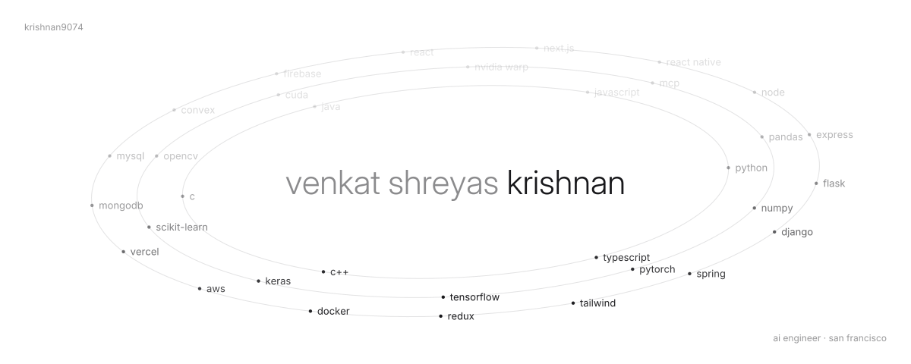
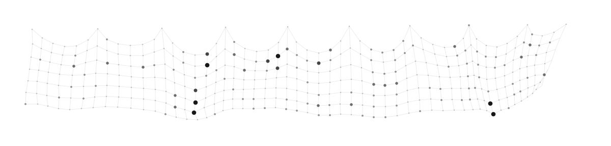

<picture>
  <source media="(prefers-color-scheme: dark)" srcset="assets/orbit-dark.svg">
  
</picture>

<picture>
  <source media="(prefers-color-scheme: dark)" srcset="assets/cloth-dark.svg">
  
</picture>

my last year of commits, simulated as cloth. busier days weigh more and hang lower. re-simulated every morning.

<a href="https://linkedin.com/in/krishnan-v-s/">linkedin</a> &nbsp;·&nbsp; <a href="https://vskrishnan.substack.com">substack</a>

